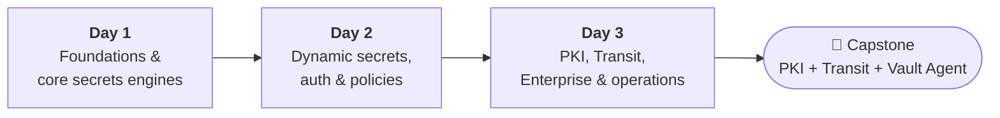

<div align="center">

# HashiCorp Vault — 3-Day Hands-On Training

**Secrets management from first principles to production operations.**
Study guides, step-by-step lab guides, lab scripts and configuration files for a three-day instructor-led course.

[](https://developer.hashicorp.com/vault)
[](https://developer.hashicorp.com/terraform)
[](https://docs.ansible.com/ansible/latest/collections/community/hashi_vault/index.html)
[](https://developer.hashicorp.com/vault/docs/platform/k8s)
[](#-labs)
[](https://www.youtube.com/@StackMasterTech)

</div>

---

## 📖 About

This repository holds the complete material for **StackMaster Tech's HashiCorp Vault training**: three days, 21 modules and 28 hands-on labs. Learners start by storing a first secret on a dev server and finish by running HA Vault on Kubernetes and building an end-to-end capstone with PKI, Transit and Vault Agent.

Every day comes as a **study guide** (concepts, diagrams, use cases, cheat sheet, quiz) and a **lab guide** (numbered steps, exact commands, config files, expected-output screenshots, checkpoints and clean-up). The two are kept in sync: each module ends with a *"Do Lab x.y"* pointer, and each lab names the module it practises.

### Who it is for

- DevOps, platform and SRE engineers who run or integrate Vault
- Security and DevSecOps engineers who replace static credentials with dynamic, short-lived ones
- Developers who need their applications to consume secrets safely
- Teams preparing for the **HashiCorp Certified: Vault Associate** exam

**Prerequisites:** comfortable on a Linux shell, basic Docker, and a working idea of HTTP/TLS. Kubernetes basics help for Day 2 Lab 2.5 and Day 3 Lab 3.9.

---

## 🗺️ Course at a glance



### Day 1 — Foundations & core secrets engines

| # | Module | Lab |
|---|---|---|
| 1 | Introduction to secrets management and why Vault | 1.1 |
| 2 | Vault architecture — storage backend, barrier, seal/unseal, Shamir's Secret Sharing | 1.3, 1.4 |
| 3 | Installation and setup — dev mode vs production mode | 1.2, 1.3 |
| 4 | Vault CLI, API and UI walkthrough | 1.5 |
| 5 | Authentication methods overview — Token, Userpass, LDAP | 1.6, 1.7 |
| 6 | KV secrets engine — v1 vs v2, versioning | 1.8 |
| — | **Day 1 capstone** | 1.9 |

### Day 2 — Dynamic secrets, auth & policies

| # | Module | Lab |
|---|---|---|
| 1 | Dynamic secrets engines — Database, AWS, Azure | 2.1, 2.2 |
| 2 | Policies and access control — ACL syntax, least privilege | 2.3 |
| 3 | Auth methods deep dive — AppRole, Kubernetes, JWT/OIDC | 2.4, 2.5, 2.6 |
| 4 | Leases, renewal and revocation | 2.7 |
| 5 | Response wrapping and cubbyhole | 2.8 |
| — | **Day 2 capstone** | 2.9 |

### Day 3 — PKI, Transit, Enterprise & operations

| # | Module | Lab |
|---|---|---|
| 1 | PKI secrets engine — root/intermediate CA, certificate issuance | 3.1 |
| 2 | Transit secrets engine — encryption as a service | 3.2 |
| 3 | Auto-unseal (cloud KMS integration) and seal wrapping | 3.3 |
| 4 | Vault Agent and Vault Agent templating | 3.4 |
| 5 | High availability, replication (Enterprise), disaster recovery | 3.5 |
| 6 | Monitoring, audit devices and best practices | 3.6 |
| 7 | Basic troubleshooting — logs and common issues | 3.7 |
| 8 | Automation with Terraform and Ansible | 3.8 |
| 9 | Implementing Vault on Kubernetes | 3.9 |
| 10 | **Capstone** — PKI + Transit + Vault Agent end to end | 3.10 |

---

## 🧪 Labs

<details>
<summary><b>Day 1 — 9 labs (≈ 3 h 25 min)</b></summary>

| Lab | Title | Time | Environment |
|---|---|---|---|
| 1.1 | Secret-sprawl audit (grep + gitleaks) | 10 min | Any shell + Docker |
| 1.2 | Install Vault and run a dev server | 15 min | Dev server |
| 1.3 | Production-style server: config, init, unseal, seal | 35 min | systemd server |
| 1.4 | Shamir's Secret Sharing in Python | 10 min | Python |
| 1.5 | CLI, API and UI: the same task three ways | 15 min | Dev server |
| 1.6 | Tokens, policies and Userpass | 25 min | Dev server |
| 1.7 | LDAP auth with OpenLDAP | 25 min | Dev server + Docker |
| 1.8 | KV v1 vs v2 and versioning | 25 min | Dev server |
| 1.9 | Day 1 capstone | 45 min | Scripted Raft server |

</details>

<details>
<summary><b>Day 2 — 9 labs (≈ 4 h 15 min)</b></summary>

| Lab | Title | Time | Environment |
|---|---|---|---|
| 2.1 | PostgreSQL dynamic secrets | 35 min | Dev server + Docker |
| 2.2 | AWS and Azure dynamic secrets *(optional)* | 20 min | Dev server + cloud account |
| 2.3 | Least-privilege policies and identity groups | 25 min | Dev server |
| 2.4 | AppRole and Vault Agent | 30 min | Dev server + Lab 2.1 |
| 2.5 | Kubernetes auth with kind and the Agent Injector | 35 min | kind cluster |
| 2.6 | JWT (GitHub Actions) and OIDC *(optional)* | 25 min | Public Vault URL / IdP |
| 2.7 | Leases, renewal and revocation | 20 min | Dev server + Lab 2.1 |
| 2.8 | Response wrapping and cubbyhole | 20 min | Dev server |
| 2.9 | Day 2 capstone | 45 min | Dev server + Docker |

</details>

<details>
<summary><b>Day 3 — 10 labs (≈ 5 h 40 min)</b></summary>

| Lab | Title | Time | Environment |
|---|---|---|---|
| 3.1 | PKI: two-tier CA, issue, verify, revoke | 35 min | Dev server |
| 3.2 | Transit: encrypt, rotate, rewrap, data keys | 25 min | Dev server |
| 3.3 | Transit auto-unseal and recovery keys | 25 min | Dev server + seal node |
| 3.4 | Vault Agent: templates, pkiCert, exec, API proxy | 35 min | Dev server + Lab 3.1 |
| 3.5 | Three-node Raft: failover and snapshots | 35 min | Local Raft cluster |
| 3.6 | Telemetry, Prometheus and audit devices | 25 min | Dev server + Docker |
| 3.7 | Break-fix troubleshooting (five faults + `vault debug`) | 30 min | Dev server + dev-TLS server |
| 3.8 | Terraform and Ansible automation | 40 min | Raft cluster (Lab 3.5) |
| 3.9 | Vault HA on Kubernetes with Helm and VSO | 45 min | kind cluster |
| 3.10 | Capstone: PKI + Transit + Vault Agent | 45 min | Dev server + nginx |

</details>

---

## 📂 Repository layout

```text
.
├── README.md
├── Vault_Day1_Study_Guide.pdf
├── Vault_Day2_Study_Guide.pdf
├── Vault_Day3_Study_Guide.pdf
├── Vault_Lab_Guide_Day1_Day2.pdf
├── Vault_Lab_Guide_Day3.pdf

> The PDFs are the source of truth. Every file under `labs/` appears in full in the lab guide, at the step that uses it.

---

## 🚀 Quick start

Tested path: **Ubuntu 22.04 / 24.04**, 2 vCPU, 4 GB RAM (8 GB for the Kubernetes labs).

```bash
# 1. Install Vault from the official HashiCorp apt repository
wget -O- https://apt.releases.hashicorp.com/gpg | sudo gpg --dearmor -o /usr/share/keyrings/hashicorp-archive-keyring.gpg
echo "deb [signed-by=/usr/share/keyrings/hashicorp-archive-keyring.gpg] https://apt.releases.hashicorp.com $(lsb_release -cs) main" \
  | sudo tee /etc/apt/sources.list.d/hashicorp.list
sudo apt update && sudo apt install -y vault terraform jq curl git openssl docker.io

# 2. Start a dev server (terminal 1)
vault server -dev -dev-root-token-id=root

# 3. Use it (terminal 2)
export VAULT_ADDR=http://127.0.0.1:8200 VAULT_TOKEN=root
vault status
vault kv put secret/hello msg=world
vault kv get secret/hello
```

Then open **Lab 1.2** in `docs/Vault_Lab_Guide_Day1_Day2.pdf` and continue from there. The full tool list for each day (kind, kubectl, helm, Ansible + `hvac`, nginx, sqlite3) is in the *One-time machine setup* section of each lab guide.

---

## 🧭 How to use this material

1. **Read the module** in the study guide: concepts, diagrams and use cases.
2. **Do the lab** it points to, in the lab guide. Type the `$` lines; create each file block exactly as shown.
3. **Compare** your terminal with the *Expected output* image. Only the highlighted (amber) lines need to match. Tokens, keys, IDs, serial numbers and timestamps will be different.
4. **Check** the ✓ Checkpoint before you move on.
5. **Clean up** with the lab's own clean-up block, or use the reset scripts in each lab guide's appendix.

### Lab environments and ports

| Environment | Started in | Ports |
|---|---|---|
| Dev server | Lab 1.2 (and most labs after it) | 8200 |
| systemd server | Lab 1.3 | 8200 |
| Transit seal node | Lab 3.3 | 8210 / 8211 |
| Three-node Raft cluster | Lab 3.5 | 8210–8231 |
| Dev-TLS server | Lab 3.7 | 8300 |
| kind clusters | Labs 2.5, 3.9 | — |

Only one server can use a given port at a time. Each lab guide's appendix lists the common clashes and how to fix them.

---

## ⚠️ Lab safety notes

- Root tokens, `-key-shares=1`, `tls_disable` and dev servers are **lab shortcuts**. Each lab says what production does instead, and the study guides show the production configuration.
- Every password, token, key and card number in this repository is a **lab-only test value**. Do not reuse them anywhere.
- Never commit real secrets, unseal keys, recovery keys or `init.json` files. Add them to `.gitignore`:

```gitignore
**/init.json
**/unseal-token
**/role_id
**/secret_id
**/*.snap
**/terraform.tfstate*
**/.terraform/
```

---

## 📚 References

- [Vault documentation](https://developer.hashicorp.com/vault/docs) · [Release notes](https://developer.hashicorp.com/vault/docs/updates/release-notes)
- [PKI](https://developer.hashicorp.com/vault/docs/secrets/pki) · [Transit](https://developer.hashicorp.com/vault/docs/secrets/transit) · [Seal / auto-unseal](https://developer.hashicorp.com/vault/docs/configuration/seal)
- [Vault Agent templates](https://developer.hashicorp.com/vault/docs/agent-and-proxy/agent/template) · [Integrated storage (Raft)](https://developer.hashicorp.com/vault/docs/internals/integrated-storage)
- [Production hardening](https://developer.hashicorp.com/vault/docs/concepts/production-hardening) · [Audit devices](https://developer.hashicorp.com/vault/docs/audit) · [Telemetry](https://developer.hashicorp.com/vault/docs/internals/telemetry/metrics)
- [Vault on Kubernetes (Helm)](https://developer.hashicorp.com/vault/docs/platform/k8s/helm) · [Vault Secrets Operator](https://developer.hashicorp.com/vault/docs/platform/k8s/vso)
- [Terraform Vault provider](https://registry.terraform.io/providers/hashicorp/vault/latest/docs) · [community.hashi_vault](https://docs.ansible.com/ansible/latest/collections/community/hashi_vault/index.html)

---

## 🤝 Feedback and contributions

Found a typo, a command that behaves differently on your Vault version, or a lab step that could be clearer? Please [open an issue](../../issues) with the lab number, the step, your Vault version (`vault version`) and the output you got. Pull requests for fixes are welcome.

---

## 👤 Author

**Vivek Arora** — Corporate Trainer, Author & Consultant, [StackMaster Tech](https://www.youtube.com/@StackMasterTech), Bengaluru

16+ years across Cloud, Data Engineering, Observability, SRE, DevSecOps and Generative AI · 140+ training batches · 55+ enterprise clients

[](https://www.linkedin.com/in/vivek11arora)
[](https://www.youtube.com/@StackMasterTech)
[](https://github.com/vivek9325)
[](mailto:vivek9325@gmail.com)

For corporate training enquiries, reach out on LinkedIn or by email.

---

## 📄 License and trademarks

© 2026 Vivek Arora / StackMaster Tech. All rights reserved. The material is shared for personal learning. Please contact the author before reusing it in commercial training.

HashiCorp, Vault, Terraform and Consul are trademarks of HashiCorp, Inc. This course is independent and is not affiliated with or endorsed by HashiCorp.
